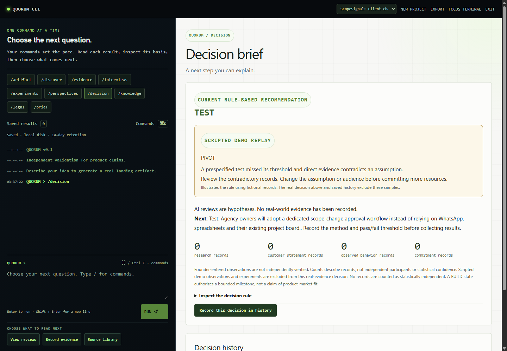
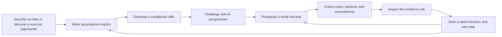
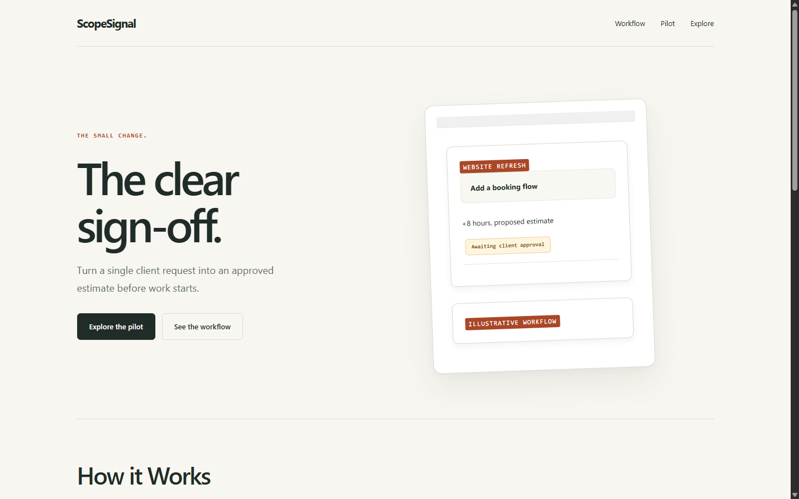
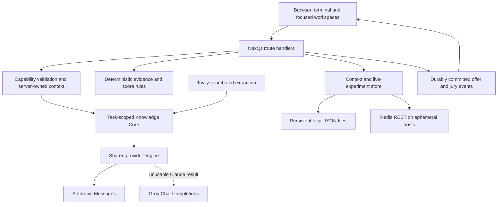
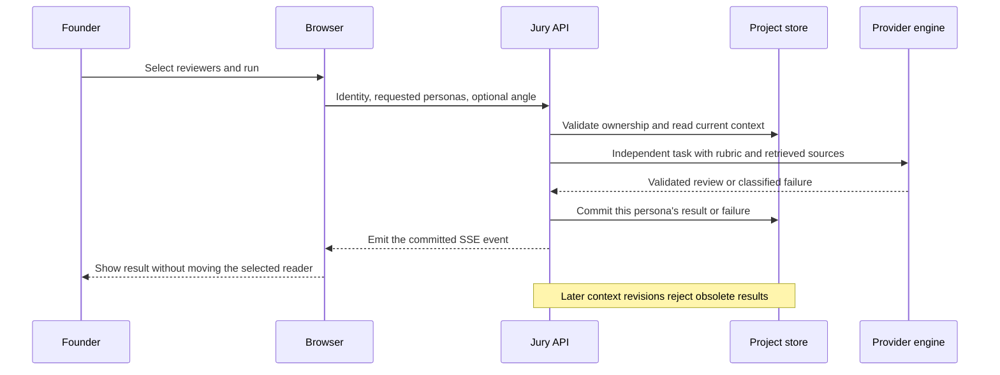
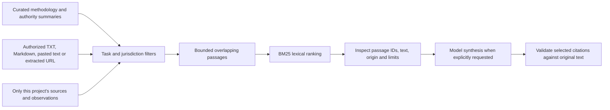
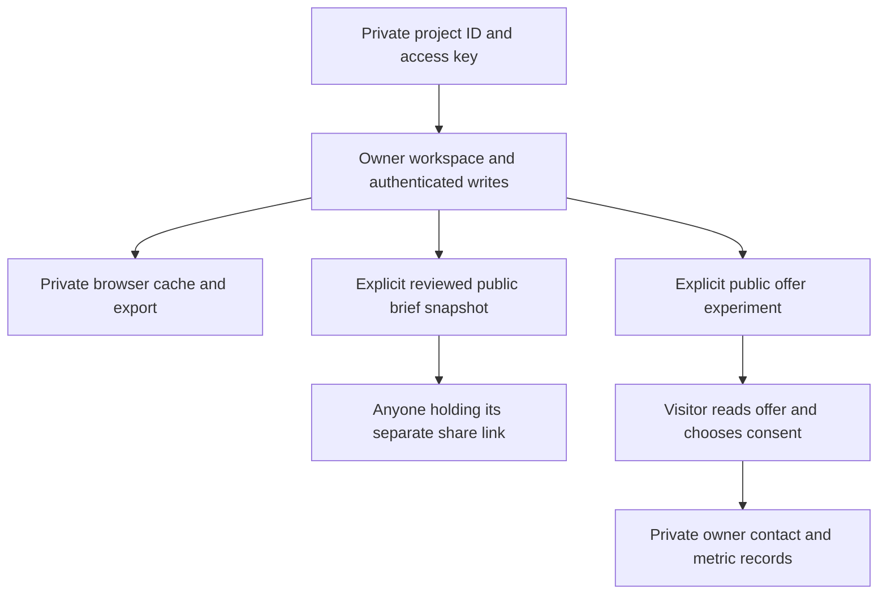

# Quorum

### From a product idea to a traceable next test.

Quorum is a terminal-first decision workspace for solo founders and small product teams. Describe an idea, turn it into a concrete offer, challenge it with independent AI perspectives, collect observations, and retain the evidence behind the next development decision.

The central distinction is simple: an AI assessment, a public research source, and observed customer behavior are different inputs. Quorum keeps them separate while connecting them to the same project.

**Built by XCalibur during BUILD 2026:** Justin Thomas Varghese, Jaisharan K, Lalith Kumar and Flemin J Muttath. Quorum entered the event as a theoretical solution; the team implemented the functional prototype during BUILD.

[Quick start](#quick-start) · [Product workflow](#product-workflow) · [Architecture](#architecture) · [Demo guide](#hackathon-demo) · [Verification](#verification) · [Deployment](#deployment) · [Pitch deck](Quorum%20YC%20Pitch.html)

## Product launch video

<!-- PRODUCT_LAUNCH_VIDEO_START
Upload the launch video through GitHub's README editor, then replace the placeholder
URL below with the generated GitHub attachment URL. Keep the real attachment on its
own line, surrounded by blank lines, outside a code fence. GitHub supplies its player.
Do not put an API key, private project URL or owner access key into the video.
PRODUCT_LAUNCH_VIDEO_START -->


<!-- PRODUCT_LAUNCH_VIDEO_END -->

**Maintainer setup:** edit this README on GitHub, drag the video into the editor, and move the generated attachment into the slot above. GitHub supports video uploads in repository READMEs; use an uploaded video attachment for inline playback. H.264 MP4 is a suitable compatibility choice. The placeholder itself is not a playable asset. See [GitHub video uploads](https://github.blog/changelog/2021-05-13-video-uploads-now-generally-available/) and [supported attachments](https://docs.github.com/en/get-started/writing-on-github/working-with-advanced-formatting/attaching-files).

## At a glance

| Property | Implementation |
| --- | --- |
| Product | A founder decision workspace organized around explicit commands |
| Primary user | A solo technical founder or small B2B team choosing its next bounded test |
| Interface | Dark terminal, focused reading canvas, explicit actions, responsive mobile navigation |
| Application | Next.js 16.3.1 App Router, React 19.1, TypeScript 5.8 |
| AI routing | Claude first; configured Groq after genuine unusable Claude output |
| Retrieval | Project-isolated BM25 passages, source metadata and exact quotation checks |
| Persistence | Atomic local JSON files or a compatible Redis REST service |
| Decisions | Inspectable application rules, independent of AI panel agreement |
| Access | Browser-held private capability keys; separate public sharing identifiers |
| Current maturity | Functional hackathon prototype; customer demand and retention remain unvalidated |



*Actual application UI with an authored demonstration dataset. The separate demo replay is not customer validation. Capture provenance is documented in [the asset notes](docs/assets/PROVENANCE.md).*

## Contents

1. [The problem Quorum addresses](#the-problem-quorum-addresses)
2. [Product workflow](#product-workflow)
3. [Features and boundaries](#features-and-boundaries)
4. [Quick start](#quick-start)
5. [Configuration reference](#configuration-reference)
6. [Terminal commands](#terminal-commands)
7. [Hackathon demo](#hackathon-demo)
8. [Architecture](#architecture)
9. [AI execution and failure handling](#ai-execution-and-failure-handling)
10. [Knowledge Core and retrieval](#knowledge-core-and-retrieval)
11. [Evidence and decision semantics](#evidence-and-decision-semantics)
12. [Persistence, access and privacy](#persistence-access-and-privacy)
13. [HTTP interface](#http-interface)
14. [Verification](#verification)
15. [Deployment](#deployment)
16. [Repository layout](#repository-layout)
17. [Troubleshooting](#troubleshooting)
18. [Scope and next steps](#scope-and-next-steps)
19. [Contributing and repository hygiene](#contributing-and-repository-hygiene)

## The problem Quorum addresses

Generating software and persuasive copy is easier than knowing whether a proposed product deserves another week of development. A founder can accumulate research links, encouraging conversations, polished mockups and AI feedback without identifying which assumption remains untested.

Today that material often ends up in chat threads, documents, spreadsheets and separate survey or landing-page tools. The missing connection is between what the founder believed, the test they chose, the observation they recorded and the decision they changed.

Quorum makes that connection explicit. Its output is a next test with inspectable context. It does not predict startup success, certify product-market fit, or turn simulated buyers into a customer sample. The recurring value proposition is itself a hypothesis to test with founders.

## Product workflow



A typical session starts with a fresh workspace. Demo Autofill can populate its draft inputs, but it never submits a form, calls a model, publishes an offer or writes a research record. The founder chooses the normal action for the current step. Saved projects are available through explicit selection in the project dropdown.

The workflow is deliberately incremental. A founder can read one reviewer, inspect a source, record an objection and return later with a better observation. Opening a saved result does not generate another response.

## Features and boundaries

| Feature | What it does | How to interpret the result |
| --- | --- | --- |
| Discover | Searches with Tavily or analyzes an attributed supplied excerpt; retains source IDs, quotations and limitations | A sourced opportunity is a proposal. Citation presence does not establish prevalence or demand. |
| Offer generation | Produces a responsive static product page with a product-specific mockup and consistent design primitives | The page describes an offer. It is not a deployed customer product or proof of adoption. |
| Six AI perspectives | Runs Analyst, Advocate, Skeptic, First-time buyer, Competitor user and Budget-conscious reviewer independently | These are simulated perspectives, not six customers or independent empirical samples. |
| Custom customer profile | Adds behavior, alternatives, buying responsibility, budget uncertainty and switching constraints to one reviewer role | The profile is founder-defined context and remains a hypothesis. |
| Scorecards and objections | Preserves ordinal scores, unknowns, risks, specific objections and panel coverage | Agreement and desirability are separate. Missing values do not become favorable scores. |
| Marketing angles | Generates alternative expressions of the same offer and supports their review | Better copy does not establish customer demand or a causal conversion improvement. |
| Knowledge Core | Imports authorized material, retrieves relevant passages and produces source-grounded answers | Retrieval relevance and exact quotes still require interpretation and source review. |
| Evidence Ledger | Connects supporting, contradicting and mixed records to stored assumptions | Records are founder-reported and are not independently verified participants. |
| Interviews | Provides preparation, stores permissioned notes and synthesizes findings with exact-source quote checks | No recruiting, recording or transcription service is included. Imported notes may not be verbatim recordings. |
| Experiment notebook | Records criteria before results, then tracks numerator, denominator, dates and limitations | Thresholds are founder decision rules, not statistical significance or market validation. |
| Quorum Live | Publishes a static offer with consented interest or interview-request capture, optional visit measurement and private counts | Email is unverified interest, not payment. Public reachability requires deployment. |
| Legal preparation | Builds a private preparation checklist from product activities and selected jurisdictions | Curated preparation, not legal advice, a live law check or launch clearance. |
| Decision and history | Applies an inspectable evidence rule, retains dated snapshots and supports a reviewed public brief | A BUILD outcome supports a bounded milestone, not product-market fit. |
| Project continuity | Supports explicit project selection, server recovery, private export, access restoration and deletion | Capability-key access has no account recovery. An export cannot resurrect an expired server record. |
| Demo Autofill | Fills the active command with a coherent ScopeSignal presentation script, with Undo | Fictional observations and outcomes carry Demo labels and do not count as real validation. |

## Quick start

### Prerequisites

- Node.js 20.9 or newer. Development and verification used Node.js 24.
- npm and access to the dependency registry for installation.
- An Anthropic API credential for the primary AI provider.
- Optional Groq recovery, Tavily search/extraction and Redis REST credentials.

The production web application does not require Python, an embedding API or a vector database. Its three runtime dependencies are Next.js, React and React DOM.

### Install and configure

```bash
git clone <YOUR_QUORUM_REPOSITORY_URL>
cd <YOUR_QUORUM_REPOSITORY_DIRECTORY>
npm ci
```

Create `.env.local` in the repository root, alongside `package.json`. Environment files, including `.env.example`, are intentionally excluded from publication. Paste the public template below and supply your own server credentials:

```dotenv
# Required primary provider
ANTHROPIC_API_KEY=replace_with_your_anthropic_key
ANTHROPIC_MODEL=claude-haiku-5-5

# Optional recovery provider; auto discovery supplies the required Groq model field
GROQ_API_KEY=
GROQ_MODEL=auto

# Optional public research and authorized URL extraction
TAVILY_API_KEY=

# Optional locally; required for persistent projects on Vercel
KV_REST_API_URL=
KV_REST_API_TOKEN=

# Optional execution limits
AI_TIMEOUT_MS=20000
AI_DEADLINE_MS=50000
AI_MAX_RETRIES=1
AI_MAX_OUTPUT_TOKENS=8192

# Optional local disk override; otherwise .quorum-data is used
QUORUM_DATA_DIR=
```

```bash
npm run dev
```

Open the address printed by Next.js. On Windows PowerShell, use `npm.cmd` if execution policy intercepts `npm.ps1`.

The arrival flow is a five-second intro, the landing page, then explicit workspace entry. Every entry begins with empty drafts. Start with your own idea or choose Demo Autofill, review its values, and press RUN. Select an older project from the dropdown only when you want to reopen it.

### Run a production build locally

```bash
npm run build
npm start
```

Restart the server after changing environment configuration. Keep credentials server-side; do not prefix them with `NEXT_PUBLIC_`.

## Configuration reference

| Variable | Required | Purpose and behavior |
| --- | --- | --- |
| `ANTHROPIC_API_KEY` | For AI product workflows | Primary provider credential. Missing configuration is an explicit error. |
| `ANTHROPIC_MODEL` | No | Claude model override; default is `claude-haiku-5-5`. Account access must be verified independently. |
| `GROQ_API_KEY` | No | Enables recovery after unusable Claude output. |
| `GROQ_MODEL` | No | Unset or `auto` discovers an available general text model. Explicit model IDs are also supported. |
| `TAVILY_API_KEY` | For live research/extraction | Enables public search and supported URL extraction. Pasted text and supplied excerpts remain alternatives. |
| `KV_REST_API_URL` | On Vercel | HTTPS Redis REST endpoint; a `redis://` TCP connection string is not the expected interface. |
| `KV_REST_API_TOKEN` | With the REST URL | Read/write token for the configured store. A read-only token cannot save projects. |
| `QUORUM_DATA_DIR` | No | Persistent local directory override. It must be excluded from Git and served by one Node process. |
| `AI_TIMEOUT_MS` | No | Default transport timeout, normally 20,000 ms. |
| `AI_DEADLINE_MS` | No | Total inference deadline, normally 50,000 ms and capped at 55,000 ms. |
| `AI_MAX_RETRIES` | No | Enables the bounded transient retry; effective policy allows at most one extra request per provider. |
| `AI_MAX_OUTPUT_TOKENS` | No | Global output safety cap; task-specific initial ceilings can be lower. |
| `AI_PROMPT_CACHE` | No | Set to `off` to disable eligible stable-prefix cache requests. Returned usage establishes actual cache use. |
| `ANTHROPIC_TIMEOUT_MS`, `GROQ_TIMEOUT_MS` | No | Provider-specific transport timeout overrides. |
| `AI_<TASK>_MODEL` | No | Claude task model override when its configured model ownership is Anthropic. |
| `GEMINI_API_KEY`, `GEMINI_MODEL` | Diagnostic only | Retained adapter for explicitly requested connectivity checks; never an automatic product fallback. |

Production tasks are `generate`, `jury`, `marketing`, `confidence`, `discover`, `interview` and `knowledge`. The `confidence` route prepares an interview kit; its name does not imply a calibrated probability.

Legacy `AI_PROVIDER`, foreign per-task provider selectors and `AI_FALLBACK_PROVIDERS` do not override the Claude-first product policy. Explicit diagnostic probes can test a provider without changing that policy. Do not add keys to source files, screenshots, public offer content or presentation assets.

## Terminal commands

Commands distinguish reading saved work, starting an AI operation and performing an explicit application action.

| Command | Behavior |
| --- | --- |
| Plain idea text + RUN | Generate an offer from the submitted idea and optional assumptions |
| `/artifact` | Open the offer workspace or saved artifact |
| `/analyst`, `/advocate`, `/skeptic` | Run the selected reasoning perspective |
| `/first-time-buyer`, `/competitor-user`, `/budget-conscious` | Run a simulated buyer perspective |
| Multiple reviewer commands in one input | Run those selected reviewers together |
| `/randomize` | Run three selected-at-random perspectives |
| `/reviews`, `/scorecard` | Inspect saved responses and panel assessments |
| `/inspect <persona>` | Open that saved reviewer's concise decision summary |
| `/angles` | Generate alternative marketing messages |
| `/kit` | Generate interview questions, outreach and a proposed test |
| `/summary` | Read the available panel summary and next step |
| `/discover` | Open sourced opportunity research inputs |
| `/evidence`, `/interviews`, `/experiments` | Open evidence, source-note and experiment workflows |
| `/perspectives` | Define the focused simulated customer profile |
| `/knowledge` | Manage sources, preview retrieval and ask cited questions |
| `/legal` | Prepare the private product/jurisdiction checklist |
| `/decision`, `/brief` | Inspect the evidence rule, dated history and decision brief |
| `/history` | Reopen a retained output version without inference |
| `/share` | Review the brief before creating a public snapshot |
| `/reload` | Explicitly recover the current project's server-committed state |
| `/export`, `/restore` | Download a private archive or restore access to its existing server record |
| `/clear` | Start fresh while retaining saved projects |
| `/delete` | Delete the current project after confirmation |
| `/cancel`, `/help` | Cancel the current operation or inspect command guidance |

Type `/` for suggestions. Arrow keys select a suggestion; Tab or Enter accepts a partial command without executing it. Enter runs the accepted input, Shift+Enter inserts a newline, and Ctrl/Cmd+K reveals and focuses the terminal. With suggestions closed, up/down recalls earlier commands.

On desktop, the terminal stays on the left while the reading canvas changes on the right. On smaller screens the terminal collapses. Incoming reviewer results preserve the selected perspective; reading earlier logs pauses automatic scrolling and exposes a jump-to-latest action.

## Hackathon demo

The shared fixture is **ScopeSignal**, a proposed approval workflow for agencies with 5-30 employees. A client adds a booking flow to a website brief; request, estimate and written approval become scattered. A scripted buyer recognizes the problem but objects to another standalone project tool. The proposed INR 1,499 price belongs to this fictional product scenario, not a Quorum subscription.

| Step | Presenter action | What to show |
| --- | --- | --- |
| 1 | Start Quorum, Demo Autofill, RUN | Fresh inputs, explicit execution and a generated offer |
| 2 | Run reviewers; fill `/perspectives` if wanted | Independent objections, unknowns and switching constraints |
| 3 | `/evidence`: fill, add assumption, save observation | A source-linked Demo record; the saved assumption becomes selectable |
| 4 | `/interviews`: fill, save, synthesize | The original scripted notes and exact supported findings |
| 5 | `/experiments`: fill and save plan; fill again after result editors appear | Locked criteria and a labelled scripted three-of-eight result against a four-example threshold |
| 6 | Optional Quorum Live publication | Explicit publication, synthetic demo contact autofill and actual captured counts |
| 7 | `/knowledge`: fill, import, ask | Project-scoped source material and cited model synthesis |
| 8 | `/legal`: fill, create checklist, fill newly created task notes | Concrete preparation questions with no claim of adviser approval |
| 9 | `/decision` | Real evidence status alongside a clearly separate scripted replay |

Filling inputs is reversible through Undo. It does not run agents or create records. Save, generate, synthesize and publish remain separate user actions. File uploads, actual account credentials and genuinely unknown publication dates are not invented to fill a box.

Scripted observations, interviews and results carry persistent Demo labels. They are excluded from real evidence decisions, including positive fictional commitments. A separate display-only replay demonstrates how the same rules would react to the scripted case. The actual public visitor form has a synthetic-contact fill control only for offers explicitly titled `[DEMO]`; ordinary visitor forms retain their normal empty defaults and consent flow.

See the [current presentation route](docs/QUORUM_HACKATHON_POLISH.md), [fresh-entry behavior](docs/QUORUM_FRESH_START.md), and [older manual walkthrough](docs/QUORUM_DEMO_RUNBOOK.md). The older manual files are a separate fictional script; do not mix their historical scenario values with current Autofill.



*Actual model-generated HTML rendered through Quorum's static artifact pipeline. An illustrative mockup is not a claim that ScopeSignal itself has launched.*

## Architecture



The application uses one shared provider engine rather than page-specific provider rules. All seven AI routes pass explicit tasks, a bounded context and an output validator. Scoring arithmetic, evidence eligibility, legal checklist selection, storage and publication counts remain application logic.

Private writes send project identity and current creation inputs. Server-owned artifacts, reviews, evidence and other derived records are hydrated from storage. A client cannot replace them by repeatedly submitting a modified full project snapshot.

### A reviewer request



Each reviewer completes independently. One failure does not erase another completed result. Targeted retries replace the relevant persona entry rather than appending duplicates. Saved results survive a disconnected browser and can be reopened explicitly.

## AI execution and failure handling

The order is **Claude first, then configured Groq after genuine failure, then an explicit error if no usable result is available**.

| Condition | Policy |
| --- | --- |
| Valid Claude JSON satisfying the feature contract | Return it immediately; no Groq call |
| Skeptical conclusion, low score, negative recommendation or valid abstention | Successful output; no fallback based on sentiment |
| Network, timeout, rate limit or provider-service failure | At most one bounded transient retry |
| Malformed JSON, invalid schema or truncation | At most one structured-output recovery attempt |
| Authentication, billing, context-limit or unsupported-model failure | Do not repeat a permanent error; configured Groq may recover |
| Explicit provider refusal or cancellation | Stop; do not bypass it through another provider |
| Missing Claude credential | Clear configuration error rather than silent Groq-only execution |
| Both providers fail | Safe actionable error; no mock success or placeholder artifact |

There are at most two inference requests per provider: the initial request and either one retry or one repair. With both providers that is at most four inference requests. Groq automatic discovery can also make a cached catalog request, which is not an inference call.

When recovery is configured, the first provider receives at most 65% of the total deadline so another provider has time to run. All retries and waits share the same deadline. JSON is buffered until validation; partial Claude text is never joined to a Groq result. Offer and jury streams report actual provider-switch and retry states.

### Output and usage budgets

| Task | Initial output ceiling |
| --- | ---: |
| Offer generation | 8,192 tokens |
| Discover | 4,096 tokens |
| Knowledge / interview synthesis | 2,048 tokens |
| Reviewer / interview kit | 1,600 tokens |
| Marketing angles | 1,200 tokens |
| Connectivity probes | 256 tokens |

The global cap can lower these limits. Truncation recovery can increase a task allowance by 1.5x within that cap. A ceiling is not measured consumption or a promised saving.

Attribution records the actual provider/model, duration, attempts, fallback reason and validation status. Input, output, cache-read and cache-creation counts are recorded only when returned by the provider. Missing counts remain unknown. Process-local aggregates retain no private prompts.

The stable jury rubric requests supported Claude prefix caching when eligible. Only returned cache usage demonstrates an actual cache hit. Reusing an identical saved Knowledge answer is a separate application optimization, restricted to unchanged inputs, source text, limitations, project revision and legal scope. There is no cross-customer answer cache.

## Knowledge Core and retrieval

Knowledge Core supplies one retrieval path to offer generation, research interpretation, reviewers, marketing, interview work and cited question answering.



The initial catalog contains 17 labelled methodology and authority-reference summaries. These are Quorum summaries with links, not publisher-authored quotations. Imported documents, Discover excerpts, evidence, permissioned interviews, experiment records and recent decision summaries remain scoped to their project. Other reviewers' responses, private legal notes, public contacts and access keys are excluded from retrieval.

Documents are split into bounded passages, ranked lexically, filtered by task/location and limited per source. Current defaults retrieve up to six passages, with a hard maximum of eight and at most two from one source. This favors inspectability and a small operational footprint. Lexical retrieval can miss synonyms or omitted context; a good ranking is not factual verification.

Each saved request can retain the passages actually supplied, their source identifiers, provenance, version, dates and limitations. Ranking scores and matched terms remain inspectable without being needlessly repeated in the model prompt. Quote options avoid duplicate text only when they cover the full passage; short contradictory lines are retained.

No matches produces an abstention without an inference call. Users can preview retrieval, import authorized text, upload TXT/Markdown, extract a public URL through Tavily, edit or pause a source, refresh an extracted source, or delete it. Imported documents cannot be promoted into legal authority; legal retrieval uses curated authority references only.

An imported document supports 30-60,000 characters. A project supports up to 12 imported documents. Sources require limitations and permission to store/process their contents. See [retrieval design and boundaries](docs/QUORUM_RAG.md).

## Evidence and decision semantics

### Evidence categories

| Category | Appropriate use |
| --- | --- |
| Research | A source-supported observation, with provenance and scope |
| Customer statement | What a participant reported, without assuming observed behavior |
| Observed behavior | A recorded action with collection context and limitations |
| Commitment | A concrete reported commitment, with its supporting source |

Every record is connected to a stored assumption and marked supporting, contradicting or mixed. Sources, original excerpts, dates, sample information and limitations stay inspectable. Multiple records from the same person do not become independent participants.

### Inspectable decision rule

| State | Current rule |
| --- | --- |
| INSUFFICIENT EVIDENCE | No explicit assumption is stored |
| PIVOT | A sufficiently sampled prespecified test missed its threshold and direct evidence contradicts an assumption |
| ITERATE | A direct contradiction or a sufficiently sampled missed threshold needs attention |
| TEST | Mixed direct evidence, contradictory research, unresolved assumptions or insufficient support remains |
| BUILD | Every assumption has behavioral support, a sufficiently sampled prespecified test met its criterion, and an associated supporting commitment exists |

These are conservative workflow heuristics. They are not probabilities, statistical tests, legal authorization or forecasts of startup success. Contradictory and mixed material remains relevant even when an offer looks polished.

Experiments lock their plan criteria at creation. Result records include actions, denominator, date and limitations. A result predating the plan cannot be presented as prespecified. Historical observations belong in the evidence workflow with the appropriate limitations.

### Panel scoring

Willingness and trust use higher-is-better ordinal anchors from 1 to 5. **Price resistance uses lower-is-better anchors.** Favorable aggregation uses `6 - resistance`; the original resistance value retains its negative meaning. Unknown or unsupported judgments remain null.

Panel coverage, ranges and dispersion describe simulated assessments. One reviewer cannot establish QUORUM. A complete panel can agree that an offer is poor, and agreement alone never authorizes BUILD. Failed or stale results remain inspectable while being excluded from current scoring.

## Persistence, access and privacy

### Ownership and public surfaces



Private projects use a separate capability key held by the browser. A project ID alone does not authorize private access. There are no user accounts, team roles, password recovery or account-based revocation in this prototype. Treat private exports and browser storage as sensitive.

Public briefs use separate revocable identifiers and explicit field allowlists. They omit raw evidence/interviews, legal preparation, imported documents, retrieval history, contacts and the private key. Generated summaries may still reflect source material, so the owner reviews content before sharing. Public offer links expose their selected static artifact and disclosure rather than the private project.

### Storage modes

| Mode | Suitable use | Boundary |
| --- | --- | --- |
| Local JSON | One Node process with a genuinely persistent disk | Atomic writes and process-local serialization; not a shared multi-instance database |
| Redis REST | Ephemeral/serverless hosting or multiple application instances | Compatible REST endpoint and read/write token; owner-checked bounded mutation leases |

Writes are not reported as successful when persistence fails. Local files are stored under `.quorum-data/` by default. The project archive limit is 2 MB, with bounded collections and explicit errors instead of silent eviction. Browser cache retains up to 20 meaningful projects; empty startup drafts do not consume those slots.

### Retention and deletion

| Record | Retention behavior |
| --- | --- |
| Server project | Expires after 14 days of inactivity |
| Shared brief | Expires 14 days after creation or refresh |
| Public offer and its contacts | Expires 14 days after experiment creation |
| Local expired files | Access enforces expiry; physical cleanup is opportunistic |
| Private exports and browser copies | Need their own deletion; they are separate copies |

Owners can remove observations, imported notes, source documents, snapshots, contacts, legal records and whole projects. They can revoke public briefs and close offers. Deleting an original interview does not automatically remove an excerpt already promoted into another record or a downloaded export.

The app does not add its own encryption layer or a distributed abuse gateway. Basic per-process rate limits, honeypot and timing checks, simple user-agent bot rejection and contact/visit deduplication reduce trivial misuse; they are not enterprise bot protection. Add an account/invite boundary and gateway controls before opening broad paid-key access.

## HTTP interface

Route handlers live in `app/api`. Use the UI for normal workflows; private mutations require the project's capability key. AI routes hydrate server-owned context and validate model outputs.

| Route | Responsibility |
| --- | --- |
| `GET /api/health` | Redacted configuration and process-local provider observations; no paid probe |
| `GET /api/session/[sessionId]` | Authorized recovery of an existing project |
| `DELETE /api/session/[sessionId]` | Authorized deletion and associated public-record cleanup |
| `POST /api/generate` | Offer generation and durable SSE completion |
| `POST /api/jury` | Independent reviewers, per-persona commits, failures and SSE events |
| `POST /api/marketing` | Alternative message generation |
| `POST /api/confidence` | Optional interview-kit preparation using the existing evidence verdict |
| `POST /api/discover` | Public/supplied source interpretation and stored opportunity selection |
| `POST /api/interview` | Exact-source interview synthesis |
| `POST /api/knowledge` | Import, retrieval-grounded answers and source/history management |
| `POST /api/project` | Assumptions, evidence, plans/results, private legal preparation, snapshots and sharing |
| `POST /api/live` | Owner publication, statistics, closure, contact deletion and ledger handoff |
| `POST /api/live/[publicId]` | Explicitly consented public visits or contact submissions |
| `/brief/[shareId]` | Read-only public brief surface |
| `/live/[publicId]` | Public static offer and actual interest/interview form |

Offer and jury events are emitted after their relevant durable writes. Error payloads expose safe categories/messages rather than credentials, provider bodies, stacks or full prompts. Cancellation and stale-context guards prevent obsolete work from becoming the current result.

## Verification

### Local checks

```bash
npm run lint
npm test
npm run build
```

`lint` is the repository's TypeScript no-emit check. It is not an ESLint invocation. The current automated suite contains **173 passing tests**. Tests replace external boundaries deterministically; production inference has no mock-provider success path.

Coverage includes provider precedence, genuine fallback, valid negative responses, permanent/transient failures, bounded recovery, cancellation/deadlines, reported and missing usage, output contracts, partial/all-failed juries, source/quote checks, opportunity handoff, evidence rules, Demo exclusion, stale-context rejection, storage/sharing, Redis REST mapping and fresh-entry behavior.

### Pre-demo service checks

```bash
# Real probes for configured services
npm run check:apis

# Include a running application's page and input-guard routes
npm run check:apis -- --base-url http://localhost:3000

# Require named services and save a redacted report
npm run check:apis -- --require anthropic,groq,tavily --output artifacts/preflight.json

# Explicit tiny provider probes
node scripts/provider-smoke.cjs anthropic
node scripts/provider-smoke.cjs groq

# The actual production routing policy on one tiny task
node scripts/claude-fallback-smoke.cjs

# End-to-end extraction, retrieval and cited answer with cleanup
npm run check:rag
```

These commands make real external requests and can incur provider charges. Each configured service is diagnosed explicitly; another provider passing does not hide a failed service. The readiness checker makes temporary storage probes, not customer/project records. Its expected route-input rejections verify guards, not a completed product workflow. FAIL exits 1, invalid CLI options exit 2, and no failures exits 0.

### Verified scope and practical limits

| Check | Recorded result |
| --- | --- |
| TypeScript and production build | Passed |
| Automated suite | 173 passing tests |
| Fresh-entry browser checks | 12 passed: cached sessions stay unselected; fill makes no request; RUN reaches generation |
| Complete demo browser checks | 88 passed with 16 filled responsive layouts |
| Wider UI audit | 105 layouts and 10 interaction checks passed |
| Ordinary evidence/public-form smoke | Passed saves, decision history, recovery, actual contact counts and closure |
| Real artifact generation | Groq recovery produced a valid artifact after bounded Claude timeouts; rendered at four widths |
| Hosted Redis and public deployment | Not established by the local browser/mocked adapter checks |
| Customer validation | No measured customer adoption, retention, revenue or willingness-to-pay result is claimed |

Live availability is account- and time-dependent. A prior successful smoke is not a permanent availability guarantee. Run the readiness checks against the configuration you will actually present. Screenshots and the ScopeSignal script demonstrate product behavior, not completed customer research.

Browser scripts use dedicated local Chrome debugging profiles and isolated `artifacts/ui-test-data`. `QUORUM_BROWSER_DEBUG_URL` can select that dedicated debugging endpoint. Do not point fixture writers at real project storage. Reports and browser profiles are intentionally ignored; [asset provenance](docs/assets/PROVENANCE.md) identifies the small set of curated public screenshots.

## Deployment

### Vercel or another ephemeral host

1. Import the Quorum application directory as the project root. This directory contains `package.json`, `app/`, `components/` and `lib/`.
2. Configure server-side Anthropic credentials, optional Groq/Tavily credentials, and both Redis REST variables in the hosting environment.
3. Use the normal Next.js build, `npm run build`. The inference routes use the Node runtime and declare bounded execution windows; verify compatibility with the selected hosting plan.
4. Deploy, then run the app-inclusive readiness checker against the deployed origin. Verify hosted persistence with real write/read/delete and reload tests.
5. Review the actual public offer and data-use disclosure before publishing links. Complete account/invite and gateway protections before broad exposure to paid API keys.

The app rejects persistence on Vercel when Redis REST configuration is missing. A temporary serverless filesystem is not a durable project store. Other hosts also need Redis or persistent disk even when Quorum cannot automatically recognize their filesystem lifecycle.

### Persistent local or single-host operation

Run one Node application process with a writable persistent directory. Back up records according to your own requirements and keep the directory outside source control. Storage failures remain visible; local filesystem availability and locks can still interrupt a write.

No deployment is performed by the application or these instructions. No custom domain, email service, payment processor, automatic A/B allocation or statistically calibrated winner inference is bundled.

## Repository layout

```text
app/
  api/                  Server route handlers and public capture endpoints
  brief/[sessionId]/    Public reviewed brief route
  live/[publicId]/      Public offer route
  page.tsx              Intro, landing page and explicit workspace entry
  layout.tsx            Shared application shell and styles
components/             Terminal, focused results and feature workspaces
lib/
  agents/               Provider adapters, routing, contracts and task budgets
  artifact-design.ts    Static artifact design foundation
  demo-scenario.ts      Typed, coherent ScopeSignal demo inputs
  evidence.ts           Evidence validation and deterministic decision rule
  context-store.ts      Ownership, retention, local/Redis persistence and sharing
  knowledge*.ts         Catalog, retrieval, ingestion and exact citations
  legal*.ts             Curated legal preparation and private progress
  project.ts            Identity payloads and browser archive behavior
scripts/                Tests, preflight, smoke checks and browser verification
tests/                  Automated provider, workflow, storage and UI-contract tests
docs/                   Product, implementation, operating and demo documentation
docs/assets/            Curated public screenshots and provenance
Quorum YC Pitch.html    Six-slide BUILD 2026 deck
package.json            Commands and pinned direct dependencies
package-lock.json       Reproducible npm dependency lock
```

Legacy Python experiments under the local `src/` tree are excluded from publication and are not imported by the web application. Agent instructions, private project data, environment files, generated output and raw verification captures are also excluded. The application source, tests, lockfile, documentation and presentation remain publishable.

## Troubleshooting

| Symptom | Check |
| --- | --- |
| Blank inputs after refresh | Expected. Select an older project explicitly from the dropdown if you want its saved state. |
| Autofill did not run an agent | Expected. Review the inputs and press the normal action. |
| An assumption selector is empty | Save the filled assumption first. An already-filled related draft can then select it. |
| Newly created result/task boxes are blank | Click the same command's Autofill again after creating the plan/checklist. |
| Claude authentication or access error | Verify the server credential/account/model and restart the server; use the explicit probe. |
| Groq succeeds but attribution says fallback | Inspect the failed Claude attempt. A valid Groq result does not mean Claude was healthy. |
| Provider request times out | Inspect the actual attempt/deadline diagnostics and account status; retry only the unfinished action. |
| No research results | Check Tavily configuration and source scope, or use an attributed supplied excerpt. |
| Knowledge abstains | Inspect task/location filters and matched passages; import relevant authorized material. |
| A quote is rejected | Compare it to original source text. Do not replace failed validation with an invented quotation. |
| Save fails locally | Check storage permissions, available space and filesystem locks. A displayed result is not a successful save without persistence confirmation. |
| Save fails on Vercel | Configure both Redis REST variables with write permission and redeploy. |
| Export will not restore a project | Confirm it contains the private key and that the server record still exists and has not expired. |
| Changes make old reviews stale | Expected. Context revisions preserve old versions while excluding them from current scoring. |
| Public metrics remain zero | Publish explicitly, use a reachable URL and perform consented interactions; fill alone creates no observations. |

## Scope and next steps

The prototype demonstrates the connected workflow. The next product question is whether founders complete a real test, return with new evidence and can explain why their decision changed.

Near-term work should prioritize founder studies, reliable hosted operation, account/invite access, operational observability and clear data ownership before expanding the agent panel. Team collaboration, billing, verified payments, recruiting, recording/transcription and cross-customer learning are future work rather than current features. Public-figure endorsements and predicted success scores are not part of the prototype.

The six-slide presentation follows BUILD 2026's required structure: project introduction; problem and target users; what was built; working demo and results; ingenuity and technical decisions; potential and next steps. Open [Quorum YC Pitch.html](Quorum%20YC%20Pitch.html) in a browser from a local checkout. Arrow keys, slide dots, notes and fullscreen controls support presenting. The deck's local-demo link assumes the application is running at its configured address. GitHub source preview is not a hosted execution environment for the HTML deck.

## Contributing and repository hygiene

Keep product changes small enough to review, preserve the terminal-led interaction model, and route new AI operations through the shared provider engine. A new model contract needs meaningful output validation, safe failure behavior and tests at the external boundary. Evidence features must preserve provenance, limitations, contradictory observations and the distinction between synthetic and observed data.

Before proposing a change:

```bash
npm run lint
npm test
npm run build
git status --short
```

Review the staged file list before publishing. `.gitignore` excludes secrets, local project storage, raw captures, build/cache output, Python experiments and local planning material. Ignore rules do not remove files already present in Git history; handle any historical exposure separately. Keep `package-lock.json`, application source and meaningful tests under version control.

The repository does not currently include a license file. Choose and add an explicit license before representing the project as licensed open-source software. Team attribution records authorship; it is not a license grant.

## Documentation

| Document | Purpose |
| --- | --- |
| [Fresh workspace behavior](docs/QUORUM_FRESH_START.md) | Explicit project restoration and no automatic agent execution |
| [Hackathon demo and artifact quality](docs/QUORUM_HACKATHON_POLISH.md) | Current Autofill route, Demo labels and actual rendered outputs |
| [RAG design](docs/QUORUM_RAG.md) | Source model, retrieval, citation checks and limits |
| [Legal preparation](docs/QUORUM_LEGAL_PREPARATION.md) | Curated checklist behavior and jurisdiction boundaries |
| [Implementation report](docs/QUORUM_IMPLEMENTATION_REPORT.md) | Dated engineering and verification history |
| [Manual demo runbook](docs/QUORUM_DEMO_RUNBOOK.md) | Older separate fictional walkthrough and presenter notes |
| [Public asset provenance](docs/assets/PROVENANCE.md) | What the curated screenshots demonstrate |

Dated reports describe the configuration and verification available at the time they were written. Current source behavior and a fresh readiness run take precedence over an older service result.
